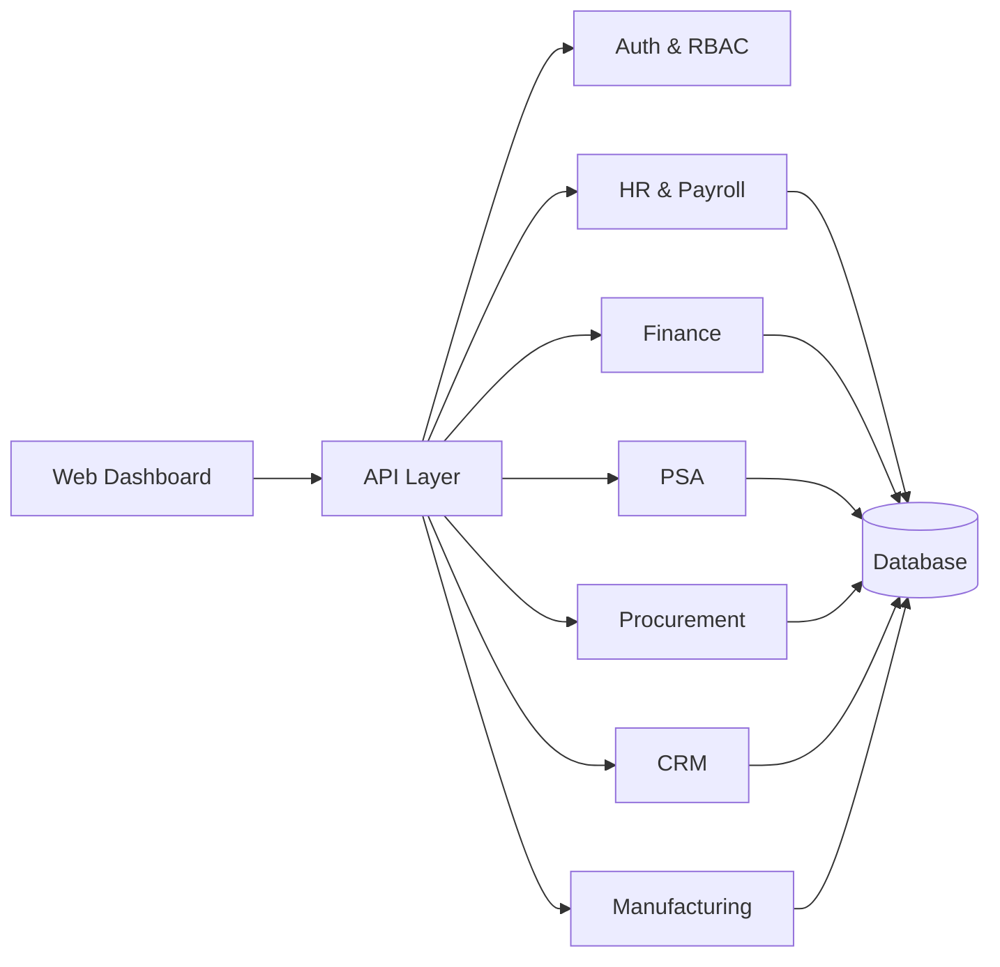

<div align="center">


<a href="https://git.io/typing-svg">
  
</a>

<br/>


<br/><br/>

[💼 Hire Me](#-freelance--hire-me) · [🏢 ERP](#-erp-system-development) · [🔥 Projects](#-featured-projects) · [🛠️ Stack](#%EF%B8%8F-tech-stack) · [📞 Contact](#-get-in-touch)

</div>

---

## 👋 About Me 

I'm a **fifth-year Software Engineering student at Arba Minch University** and a **freelance full-stack developer** based in Ethiopia 🇪🇹. I design and build **ERP systems, marketplaces, and real-time platforms** for the Ethiopian market, with local payments (Chapa, Telebirr), ETB pricing, and Amharic/English interfaces.

My work centers on production-style systems: role-based access, secure APIs, real-time features, clean architecture, and containerized deployment.

```ts
const feleke = {
  role: "Full-Stack Engineer · ERP Developer · Freelancer",
  education: "BSc Software Engineering, Arba Minch University (5th year)",
  location: "Arba Minch, Ethiopia 🇪🇹",
  core: ["Node.js / Express / TypeScript", "React", "PostgreSQL · MySQL · MongoDB", "Docker"],
  specialties: ["ERP systems", "Role-based platforms", "Payments (Chapa, Telebirr, Stripe)", "Real-time (Socket.IO)"],
  status: "Open for freelance projects & internships",
};
```

---

## 💼 Freelance & Hire Me

I take on freelance projects for businesses, startups, and organizations, from a first MVP to a full custom system.

<table align="center">
  <tr>
    <td width="33%" align="center">
      <h3>🏢 ERP Systems</h3>
      <p>HR, finance, inventory, procurement, CRM and reporting in one platform</p>
    </td>
    <td width="33%" align="center">
      <h3>🛒 Marketplaces & Platforms</h3>
      <p>Multi-role apps: delivery, e-commerce, brokerage, booking</p>
    </td>
    <td width="33%" align="center">
      <h3>🔧 APIs & Backends</h3>
      <p>Secure, documented REST APIs, auth, RBAC, webhooks</p>
    </td>
  </tr>
  <tr>
    <td width="33%" align="center">
      <h3>💳 Payment Integration</h3>
      <p>Chapa, Telebirr, Stripe, with webhooks and reconciliation</p>
    </td>
    <td width="33%" align="center">
      <h3>🐳 DevOps & Deployment</h3>
      <p>Docker, CI/CD, Linux, Vercel, Railway, Render</p>
    </td>
    <td width="33%" align="center">
      <h3>⚡ Optimization & Support</h3>
      <p>Query tuning, caching, code review, ongoing maintenance</p>
    </td>
  </tr>
</table>

**How I work**

| Step | What happens |
|:-:|:--|
| 1️⃣ **Discover** | We define goals, users, roles and the must-have features |
| 2️⃣ **Design** | Database schema, API contract and UI flow agreed before coding |
| 3️⃣ **Build** | Short iterations with regular demos and Git-based delivery |
| 4️⃣ **Launch** | Dockerized deployment, documentation and handover |
| 5️⃣ **Support** | Bug fixes, improvements and training after go-live |

<div align="center">

[](mailto:eshetufeleke21@gmail.com?subject=Freelance%20Project%20Inquiry)
[](https://t.me/xobiya)

</div>

---

## 🏢 ERP System Development

I build **custom ERP (Enterprise Resource Planning) systems** that replace spreadsheets and disconnected tools with one secure, role-based workspace. My flagship ERP project is **XobiyaHR**, an HR-centered platform that connects to finance, PSA, procurement, CRM and manufacturing flows.

<div align="center">

| Module | What it covers |
|:--|:--|
| 👥 **HR & Payroll** | Employee records, attendance, leave, payroll, org structure |
| 💰 **Finance & Accounting** | Invoices, expenses, ledgers, payments |
| 📋 **PSA (Project Services)** | Projects, tasks, timesheets, billing |
| 🛒 **Procurement** | Suppliers, purchase requests and orders, approvals |
| 🤝 **CRM** | Customers, leads, pipeline, follow-ups |
| 🏭 **Manufacturing & Inventory** | Stock, production flows, reorder alerts |
| 📊 **Reports & Dashboards** | KPIs, analytics, exports |
| 🔐 **Access & Audit** | Role-based permissions, approval workflows, audit logs |

</div>



I also built **AITB**, a 15-module Laravel enterprise system for regional project and investment management, with allocation formulas, forecasting, EVM metrics and KPI dashboards.

---

## 🔥 Featured Projects

<div align="center">

| # | Project | Domain | Stack |
|:-:|:--|:--|:--|
| 1 | [Saro Delivery](#1-saro-delivery) | Food delivery platform | React · Node · MongoDB · Socket.IO |
| 2 | [XobiyaHR](#2-xobiyahr--erp-workspace) | ERP workspace | ERP · HR · Finance · CRM |
| 3 | [CTSA](#3-ctsa--community-tool-sharing-app) | P2P tool marketplace | Node · TypeScript · PostgreSQL · Docker |
| 4 | [Arif Car Sell](#4-arif-car-sell) | Vehicle marketplace | React · TypeScript · Express · MySQL |
| 5 | [AITB](#5-aitb--regional-project-management-system) | Enterprise project system | Laravel · MySQL · Alpine.js |

</div>

### 1. Saro Delivery
**Full-stack delivery platform for Ethiopian restaurants and vendors** with real-time tracking, Chapa payments, and dashboards for four roles.

- Customer, vendor, driver and admin dashboards
- Real-time order tracking and notifications (Socket.IO)
- Interactive maps and driver navigation (Leaflet)
- Chapa payment integration for the Ethiopian market
- JWT auth, bcrypt, rate limiting, CORS, Helmet and input validation
- REST API documented with Swagger


🔗 [Repository](https://github.com/xobiya/Saro-Delivery)

### 2. XobiyaHR — ERP Workspace
**An ERP workspace for managing HR operations and the modules that connect to it**: finance, PSA, procurement, CRM and manufacturing flows.

- HR as the core, with connected business modules around it
- Role-based access and approval workflows
- Unified data across departments instead of isolated tools

🔗 [Repository](https://github.com/xobiya/XobiyaHR)

### 3. CTSA — Community Tool Sharing App
**A peer-to-peer marketplace for sharing, lending and renting tools among residents of Addis Ababa**, built to promote community collaboration and lower tool-ownership costs.

- Trusted marketplace with a reputation system (reviews & ratings)
- 10% service-fee commission revenue model
- KYC verification, JWT auth, Chapa payments, real-time chat, file upload
- Mobile-first design supporting Ethiopia's digital economy
- Dockerized backend with API documentation


🔗 [Backend](https://github.com/xobiya/CTSA_Backend) · [Frontend](https://github.com/xobiya/CTSA_Frontend)

### 4. Arif Car Sell
**An enterprise-ready vehicle marketplace and brokerage concierge system** for buyers, private sellers, licensed brokers and administrators, with ETB pricing.

- Vehicle showroom with filtering and detailed specifications
- Buyer, broker and admin roles
- Approval lifecycle: pending → approved → sold
- Lead pipeline from inquiry to negotiation to sale
- Commission earnings and sales analytics
- Shared TypeScript types between frontend and backend


🔗 [Repository](https://github.com/xobiya/car-broker-showcase)

### 5. AITB — Regional Project Management System
**A modular Laravel enterprise platform** for regional infrastructure and investment management.

- 15 integrated modules covering the project lifecycle and investment operations
- Feasibility studies, corridor management, allocation formulas, budget scaling
- Forecasting and Earned Value Management (SPI / CPI)
- KPI dashboards, document archive, notifications, system configuration
- Server-side and client-side caching


🔗 [Repository](https://github.com/xobiya/AITB)

**More work:** [Restaurant Menu & Ordering System](https://github.com/xobiya/Restaurant-Menu) (bilingual QR ordering and kitchen management) · [3D Portfolio](https://github.com/xobiya/Feleke-portfolio) ([live](https://feleke-portfolio.vercel.app)) · [Subscription Tracker API](https://github.com/xobiya/Subscription-tracker-api) · [Ogge Travel](https://github.com/xobiya/Ogge-Travel)

---

## 🛠️ Tech Stack

<div align="center">

<a href="https://skillicons.dev">
  
</a>

<br/><br/>


</div>

---

## 📊 GitHub Stats & Activity

<div align="center">


<br/>


<br/>


<br/><br/>

<picture>
  <source media="(prefers-color-scheme: dark)" srcset="https://raw.githubusercontent.com/xobiya/xobiya/output/github-snake-dark.svg" />
  <source media="(prefers-color-scheme: light)" srcset="https://raw.githubusercontent.com/xobiya/xobiya/output/github-snake.svg" />
  
</picture>

<br/><br/>


</div>

---

## 🎓 Education

- 🎓 **BSc Software Engineering**, Arba Minch University (5th year)
- 📚 Continuous self-learning in full-stack development, system design and DevOps

## 🚀 Currently Focused On

- 🏢 Expanding XobiyaHR with more ERP modules
- 🐳 Docker, CI/CD and production deployment
- 🤖 Integrating AI features into business applications
- 💼 Delivering freelance projects and preparing for a professional engineering career

## 🤝 Open To

✅ **Freelance projects** · ✅ **Internships & junior roles** · ✅ **Open-source contributions** · ✅ **Mentorship**

---

## 📞 Get In Touch

<div align="center">

[](https://www.linkedin.com/in/felek-eshetu-a6b4a0371)
[](https://github.com/xobiya)
[](mailto:eshetufeleke21@gmail.com)
[](https://t.me/xobiya)
[](https://instagram.com/feleke9063)
[](https://feleke-portfolio.vercel.app)

**📧** eshetufeleke21@gmail.com · **📱** [@xobiya](https://t.me/xobiya) · **📍** Arba Minch, Ethiopia 🇪🇹

> **"Never Give Up"** — my motto for life and code


**Made with ❤️ by Feleke Eshetu** · *Updated October 2026*

</div>
